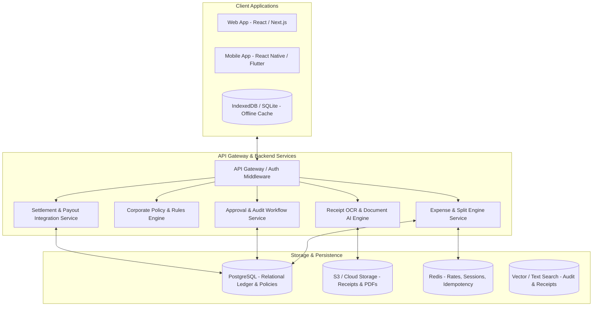
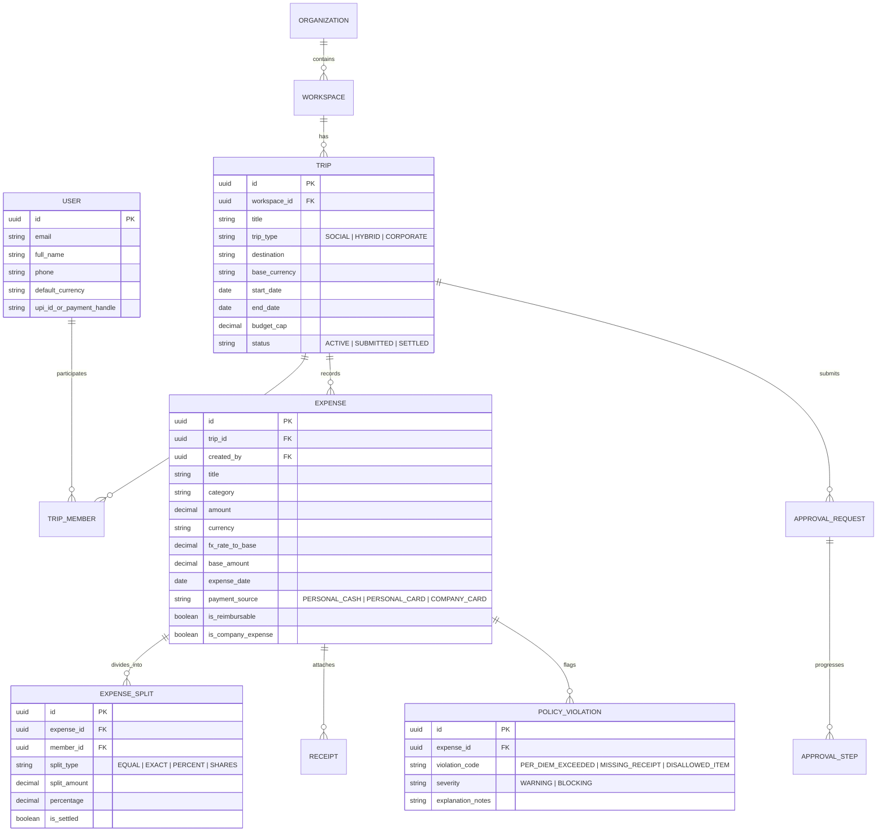

# Product Requirements Document (PRD): Omnivance Expense Engine
*From Casual Friends' Outings to Enterprise Corporate Travel*

---

## 1. Executive Summary & Vision

### 1.1 Vision Statement
To create the world's first **adaptive, modular expense tracking platform** that seamlessly scales from a 3-tap casual expense split among friends on a weekend road trip to an enterprise-grade corporate travel compliance and reimbursement engine.

### 1.2 The Core Thesis: "One Ledger, Any Journey"
Current solutions force a false dichotomy:
- **Casual Split Apps (Splitwise, Tricount)**: Excellent for friends and flatmates, but completely incapable of handling corporate policies, per-diem limits, tax breakdowns (GST/VAT), cost-center allocations, manager approval chains, or formal audit trails.
- **Enterprise Expense Tools (Concur, Expensify, Zoho Expense)**: Powerful for business compliance, but rigid, bureaucratic, expensive, and completely unusable for a casual weekend trip or after-work drinks.
- **The "Bleisure" / Team Offsite Gap**: When colleagues travel together, they face both paradigms simultaneously: company-reimbursed flights and hotel rooms alongside shared casual dinners, cab rides, and side trips split among coworkers.

The **Omnivance Expense Engine** bridges this spectrum with **Progressive Complexity**: users only see the features required for their specific trip mode, while retaining the same familiar, high-speed UX.

---

## 2. Target Personas & Use Case Spectrum

```
[ CASUAL / SOCIAL ] <=================================> [ CORPORATE / ENTERPRISE ]
  Weekend Getaway         Housemates / Flatmates     Team Offsite / Conf     Executive Sales Travel
  - Quick P2P splits      - Recurring monthly bills  - Hybrid (corp + split) - Strict per-diem caps
  - Equal/Unequal split   - Shared kitty / balances  - Project cost tagging  - Multi-tier approval
  - Direct UPI/PayPal     - Debt simplification      - Company card + cash   - ERP / Tax compliance
```

### 2.1 Persona Matrix
| Persona | Context | Key Pain Points | Primary Needs |
| :--- | :--- | :--- | :--- |
| **"The Social Splitter"** *(Alex, 24)* | Weekend trip with 5 friends | Calculating who owes whom; awkward money reminders; multi-currency calculation on foreign trips. | Minimal friction, quick receipt capture, equal/unequal splits, 1-click UPI/Venmo settle up. |
| **"The Group Treasurer"** *(Priya, 28)* | Organizing an annual group vacation (12 people) | Keeping track of shared kitty funds, advance payments, uneven participation in activities. | Shared pool/kitty balance, sub-group splitting, offline capability in remote spots. |
| **"The Corporate Nomad"** *(Marcus, 34)* | Field sales / client meetings | Losing physical receipts, exceeding hotel per-diems by accident, delayed expense reimbursements. | AI receipt OCR, automatic per-diem calculations, mileage tracking, corporate card reconciliation. |
| **"The Approving Manager"** *(Sarah, 41)* | Engineering Director with 15 direct reports | Reviewing 50-page expense spreadsheets, verifying policy compliance, spotting duplicate claims. | Exception-based approvals, automated policy violation warnings, 1-click batch approvals. |
| **"The Corporate Controller / Finance Admin"** *(David, 45)* | Head of Finance / Accounts | Inaccurate tax (GST/VAT) records, manual data entry into ERP (NetSuite/QuickBooks/Tally), audit compliance. | Immutable audit logs, exportable GL reports, automated payout execution, cost-center budget guards. |

---

## 3. Product Modes & Progressive Disclosure

The workspace adapts automatically based on the **Trip Type** selected at creation:

### Mode 1: Social & Friends Trip
- **Profile**: Zero overhead, frictionless.
- **Enabled**: Shared ledger, who paid, who shares, equal/custom splits, debt simplification, UPI/PayPal settlement links.
- **Hidden**: Approvals, policy rules, cost centers, tax invoice fields, mileage logs.

### Mode 2: Hybrid Team Offsite / Bleisure
- **Profile**: Blended company-reimbursed costs and peer-to-peer split costs.
- **Enabled**: All Mode 1 features + ability to tag expenses as *“Company Reimbursable”* vs. *“Personal Split Between Colleagues”*.

### Mode 3: Corporate Business Travel
- **Profile**: Enterprise travel and expense (T&E) management.
- **Enabled**: Trip budget pre-approval, Per Diem allowances, Corporate Card matching, Receipt OCR with tax extraction, multi-level approvals, audit log, ERP export.

---

## 4. Functional Requirements

### Module 1: Workspace & Trip Management
- **FR-1.1**: Create Trip/Workspace with attributes:
  - Name, Date range, Destination (City/Country), Base Currency.
  - Trip Type: `Social Group`, `Flatmate/Recurring`, `Team Offsite`, `Corporate Business`.
- **FR-1.2**: User Roles & Permissions per Trip:
  - *Social Mode*: Owner, Member (all can view/add/edit expenses).
  - *Corporate Mode*: Traveler/Employee, Approving Manager, Finance Auditor, Workspace Admin.
- **FR-1.3**: Offline-First Capability: All expense entries and photo captures can be made without internet connectivity, queuing locally and syncing automatically once online.

### Module 2: Smart Expense Capture & Receipt Intelligence
- **FR-2.1 Manual Entry**: 
  - Date, Category (Food, Stay, Transit, Flight, Entertainment, Supplies, Other), Amount, Currency, Payer(s), Description, Notes.
- **FR-2.2 AI-Powered Receipt OCR**:
  - Auto-extracts: Merchant name, Transaction Date, Total Amount, Tax/GST/VAT amount, Currency, and Itemized Line Items.
  - Interactive verification: Highlights extracted fields on the scanned image for instant 1-tap confirmation or edit.
- **FR-2.3 Itemized Bill Splitting**:
  - Ability to scan a restaurant bill and assign individual dishes/drinks to specific members, automatically distributing shared taxes and tips proportionally.
- **FR-2.4 Multi-Currency & Real-Time FX**:
  - Support for 160+ fiat currencies with real-time exchange rates.
  - Option to lock custom exchange rate for the trip (e.g., cash exchanged at airport).
- **FR-2.5 Mileage & Travel Allowance Tracker**:
  - Mileage tracker with Google Maps distance calculator (start/end location or odometer readings) with configurable per-kilometer/mile reimbursement rates.

### Module 3: Split Engine & Settlement (Social & Offsite Modes)
- **FR-3.1 Flexible Splitting Rules**:
  - **Equal Split**: Even division across all or selected participants.
  - **Exact Amounts**: Explicit monetary share per person.
  - **Percentage-Based**: Division by custom percentages summing to 100%.
  - **Shares/Units**: Allocation by units (e.g., 2 adults = 2 shares, 1 child = 1 share).
  - **Adjustment Split**: Equal base split plus/minus explicit offsets.
- **FR-3.2 Multiple Payers Support**:
  - Single expense paid by more than one person in unequal portions.
- **FR-3.3 Debt Simplification Algorithm**:
  - Minimize the total number of transactions required to settle a group ledger using directed graph debt reduction:
    $$\sum \text{Transactions} \ll N(N-1)/2$$
- **FR-3.4 Payment & Settlement Integration**:
  - Direct deep-links for payment settlement (UPI / Google Pay / PhonePe for India, Venmo / CashApp for US, Revolut / IBAN for EU).
  - "Mark as Settled" recording with optional settlement receipt/screenshot.

### Module 4: Corporate Travel Policy & Compliance Engine
- **FR-4.1 Per Diem Allowance Configuration**:
  - Tiered daily allowances configured by destination city tier (Tier 1 vs. Tier 2 vs. International) and job grade.
  - Half-day vs. Full-day travel allowances.
- **FR-4.2 Automated Policy Rules & Guardrails**:
  - *Mandatory Receipt Threshold*: E.g., any expense over \$25 / ₹1,000 mandates a receipt attachment.
  - *Category Spending Caps*: E.g., max \$150/night for hotel, max \$40 for dinner.
  - *Disallowed Item Flags*: Keyword detection on OCR receipts for prohibited expenses (e.g., alcohol, tobacco, personal grooming, minibar).
  - *Duplicate Expense Detection*: Automated detection of duplicate date, amount, and vendor across team members.
- **FR-4.3 Travel Advance & Petty Cash Management**:
  - Log corporate travel advances disbursed before the trip.
  - Automatic reconciliation: Travel Advance vs. Actual Reimbursable Claims = Net Payable / Receivable.

### Module 5: Approval Workflows & Audit Lifecycle
- **FR-5.1 Workflow Pipeline**:
  ```
  [ Draft ] -> [ Submitted ] -> [ Manager Approval ] -> [ Finance Audit ] -> [ Approved for Payout ] -> [ Reimbursed / Closed ]
  ```
- **FR-5.2 Approval Actions**:
  - Approve entire claim, partially approve (reject specific line items with reason), or send back for employee clarification.
- **FR-5.3 Multi-Level Approval Hierarchies**:
  - Configurable conditional routing (e.g., Claims < \$1,000 require 1-level manager approval; Claims >= \$1,000 require Department Head + VP approval).
- **FR-5.4 Immutable Audit Log**:
  - Every modification, submission, approval, rejection, and comment is timestamped and cryptographically logged for corporate compliance and tax audit.

### Module 6: Financial Settlement, Payouts & Integrations
- **FR-6.1 Batch Reimbursement Processing**:
  - Finance administrators can generate standard NACHA / SEPA / NEFT / RTGS payout batch files or trigger direct payouts via Stripe Connect / RazorpayX.
- **FR-6.2 Accounting & ERP Export**:
  - One-click export to CSV, Excel, and structured formats for:
    - QuickBooks Online, Xero, Zoho Books, NetSuite, SAP, Tally Prime.
  - Mapping to General Ledger (GL) Cost Centers, Projects, and Tax Accounts.
- **FR-6.3 Audit-Ready PDF Travel Expense Reports**:
  - Comprehensive PDF generation including executive summary, line-item ledger, category breakdown charts, policy exception declarations, and appended receipt images.

---

## 5. Technical Architecture & Data Design

### 5.1 System Architecture Diagram



### 5.2 Core Data Models (Relational Entity Relationship)



---

## 6. Debt Simplification Algorithm (The Math)

For Social and Hybrid trips, when $N$ members owe varied amounts across dozens of bills, a naive approach requires hundreds of micro-transactions.

The **Min-Cost Debt Settlement Algorithm** executes:
1. **Net Balance Calculation**:
   For each participant $i \in \{1 \dots N\}$:
   $$\text{NetBalance}_i = \sum \text{Paid}_i - \sum \text{Owed}_i$$
   The sum of all net balances is guaranteed to equal 0:
   $$\sum_{i=1}^N \text{NetBalance}_i = 0$$

2. **Partitioning**:
   - Debtors: $D = \{i \mid \text{NetBalance}_i < 0\}$ sorted ascending.
   - Creditors: $C = \{j \mid \text{NetBalance}_j > 0\}$ sorted descending.

3. **Greedy Matching**:
   Iteratively match the largest debtor with the largest creditor:
   $$\text{TransferAmount} = \min(|\text{DebtorBalance}|, \text{CreditorBalance})$$
   Produce a transfer: $\text{Debtor} \rightarrow \text{Creditor}$ of $\text{TransferAmount}$, update balances, and remove zeroed accounts until empty.
   This reduces transactions from $O(N^2)$ to at most $N-1$ transactions.

---

## 7. Non-Functional Requirements (NFRs)

| Dimension | Specification | Verification Metric |
| :--- | :--- | :--- |
| **Performance** | Expense creation response $\le 300\text{ ms}$; Receipt OCR round-trip $\le 3.5\text{ s}$. | 99th percentile APM latency monitoring. |
| **Offline Sync** | 100% of data capture functional without internet; sync resolution on reconnect. | Zero data loss during simulated offline test suites. |
| **Security & Privacy** | AES-256 at rest, TLS 1.3 in transit; RBAC enforced on all endpoints. | Penetration testing & SOC2 Type II compliance. |
| **Financial Precision** | Decimal handling using arbitrary precision (`Decimal(18, 4)`) to avoid IEEE 754 floating point rounding errors. | Comprehensive automated unit test balance checks. |
| **Auditability** | Append-only immutable transaction logs for all corporate edits and status transitions. | Change logs verified against database state. |

---

## 8. Implementation Roadmap (Phased Delivery)

```
[ Phase 1: MVP Core Ledger ] =======> [ Phase 2: Smart Travel & AI ] ======> [ Phase 3: Enterprise Suite ]
(Week 1 - 4)                          (Week 5 - 8)                           (Week 9 - 14)
- User & Trip Setup                   - AI Receipt OCR Engine                - Multi-tier Approvals
- Manual Expense Entry                - Itemized Bill Splitting              - Policy Rules & Per Diems
- Equal & Unequal Splits              - Multi-Currency & Live FX             - Corporate Card Sync
- Min-Debt Simplification             - Shared Kitty / Pool Funds            - ERP & Accounting Exports
- Direct UPI/P2P Settle Links         - Offline-First PWA Sync               - Batch Disbursement Engine
```

---

## 9. Key Performance Indicators (KPIs)

- **Time to First Expense**: $< 45$ seconds from registration to first logged expense.
- **OCR Auto-Accuracy**: $> 92\%$ accuracy on total amount, date, and vendor detection without manual override.
- **Settlement Velocity**: Average time from trip completion to 100% debt settlement $< 72$ hours (Social) and reimbursement payout $< 5$ business days (Corporate).
- **Policy Compliance Rate**: $> 95\%$ of submitted corporate expenses free from blocking policy violations on first submission.
